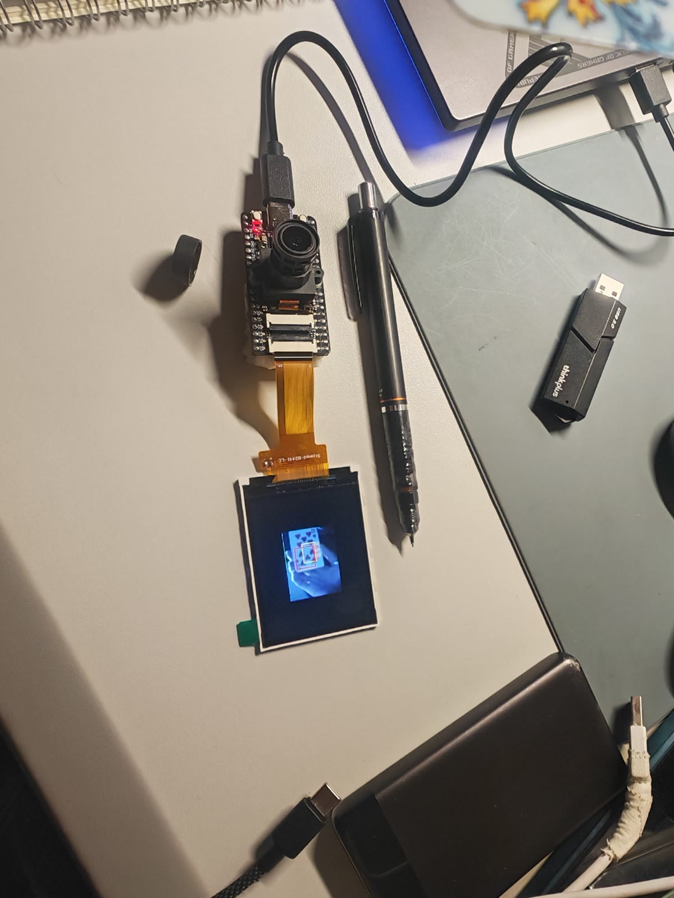
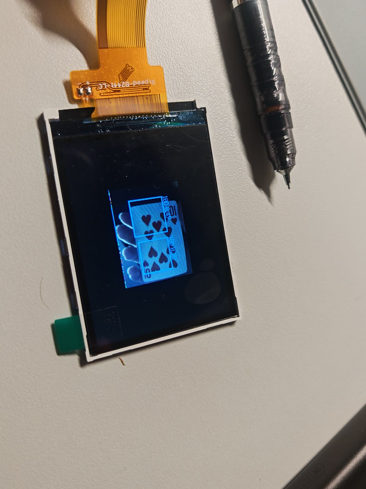

# K210 Poker Vision

一个基于 YOLOv2-tiny 的 52 类扑克牌检测与 K210 边缘部署复盘项目。

English summary: a reproducible edge-vision experiment covering dataset repair,
YOLOv2 training, ONNX/TFLite/KModel conversion, K210 memory constraints, and
honest reporting of on-device limits.

## 1. 项目来源与目标

项目起点是一组历史 K210 扑克牌检测资料。原始压缩包里有数据集、Darknet
权重、PyTorch 训练代码、checkpoint 和两个 KModel，但它们缺少可信的训练与
实机证据：旧 checkpoint 只训练了两个 epoch，类别 YAML 与实际牌面存在错位，
部署脚本也没有可靠的类别映射。

本次工作不重造 YOLOv2，而是把它整理成一条可以追问、可以复现的工程链：

- 修复数据类别契约，并隔离无法确认的标注；
- 用 RTX 4060 重新训练和评估；
- 比较 215×215、320×320 与 160×120 输入；
- 将 PyTorch 模型导出为 ONNX、TFLite 和 KModel；
- 在 Maix-Bit V2.0 上处理模型格式、KPU 内存、摄像头和 LCD 问题；
- 记录失败边界，并在继续优化已经不再服务个人目标时停止。

项目是教育、作品展示和工程复盘样例，不是生产级牌桌识别系统。

## 2. 最终结果与证据边界

数据最终包含 1,285 张图、5,573 个可用框、52 个稳定类别。原始 964/193/128
划分保持不变；1 个无法确认来源的框被隔离，而不是猜测修正。

| 验证层级 | 结果 | 可以说明什么 |
|---|---|---|
| 320×320 PyTorch | test mAP@0.5 `0.875`；mAP@0.5:0.95 `0.541`；identity accuracy `0.857`；coverage `0.933` | 桌面模型和评估链有效 |
| 320×320 KModel 模拟 | 20 图 mAP@0.5 `0.849`，同子集浮点 `0.870` | 量化损失可控，但不证明能在板上共存 |
| 320×320 KModel 实机 | 11.18 MB 文件格式失败；5.20 MB 与 3.57 MB 模型出现 `ERR_NO_MEM` | 桌面指标不能直接当作可部署结果 |
| 160×120 KModel | 2,089,896 字节，SHA-256 `060163f63db6b4bb818a3c8483ca2f686f3e7e1331bef09b7567b79422fc3b6a` | 摄像头、KPU、后处理、LCD 和检测框实际跑通 |
| e20 参考模型 | valid mAP@0.5 `0.481`；identity accuracy `0.588`；coverage `0.747`；梅花 9 AP `0.505` | 160×120 可继续优化的方向，但未完成物理复验 |

MaixPy IDE 中观察到的完整画面刷新约为 `10.4–10.8 FPS`。这不是三轮 100 帧
完整管线 benchmark，因此不作为正式 FPS 结果。300 秒稳定性测试和 104 实例
真实扑克牌 holdout 也没有完成，公开材料保持“未验证”状态。

## 3. 实现路径

```text
Roboflow CC BY 4.0 数据集
        |
        +-- 人工类别映射 / 异常框隔离
        |
        +-- 固定 964 / 193 / 128 划分
        |
        +-- YOLOv2-tiny: 320x320 浮点模型
        |
        +-- ONNX -> TFLite -> nncase KModel
        |
        +-- K210 内存准入失败
        |
        +-- 160x120 矩形输入与 K210 实机链路
        |
        +-- 52 类检测、unknown 策略与演示视频
```

320×320 模型使用 `10×10` 网格、5 个数据重估 anchor、52 类和 285 通道检测头。
K210 实跑路线改为 `160×120`，输出网格为 `7×10`。所有模式共用同一套拍照、
KPU 推理、YOLO2 解码、NMS、LCD 绘制管线。

详细决策过程见 [工程复盘](docs/engineering-review.md)，环境与部署问题见
[环境与部署说明](docs/environment-and-deployment.md)。

## 4. 实机证据

下面两张图来自真实 Maix-Bit 连接和 LCD 拍摄。第一张展示板卡、摄像头、屏幕与
USB 连接；第二张展示 LCD 上的牌面与检测框。





[55 秒实机演示](media/k210-demo.mp4) 保留了换牌和检测框显示，已去除音频、
设备元数据和无关信息。PC 端 IDE 画面与 LCD 同步曾在现场确认，但当前归档素材
主要拍摄 LCD，不用来单独证明双端同画面。

核心失败也保留在结果中：现实演示时梅花 9 持续识别失败。把 identity 阈值从
`0.20` 降到 `0.10` 后，coverage 升到 `0.885`，但 identity accuracy 降到
`0.442`。这说明降低阈值只是在强行报牌，不能作为改进。

## 5. 快速开始

源码开发入口是 Windows 终端：

```bat
start-dev.bat status
start-dev.bat test
start-dev.bat release
```

启动器优先读取环境变量 `POKER_VISION_CENTRAL_PYTHON`，也会根据本机已有工具链
变量自动发现集中环境；未发现时使用项目 `.venv`，再回退到锁文件与 `uv`。
`uv` 缺失时只下载固定版本到项目 `.tools`，不会修改全局 PATH。具体变量见
环境与部署说明。

仓库的 GitHub Release 包含两个包：

- `k210-poker-vision-pc-v1.0.0.zip`：源码、测试、终端菜单和硬件联动脚本；
- `k210-poker-vision-sd-v1.0.0.zip`：FAT32 SD 一键安装、默认 KModel、
  SHA-256 清单和 MaixPy 运行代码。

SD 安装器不会格式化卡，也不会自动刷固件。详细步骤见
[环境与部署说明](docs/environment-and-deployment.md)。

重新训练和评估使用 `poker-vision` CLI：

```powershell
poker-vision audit-data --source <dataset-dir> --output artifacts/data/prepared
poker-vision train --data-dir artifacts/data/prepared --cfg configs/yolov2-tiny-52-320.cfg --weights <yolov2-tiny.weights> --estimate-anchors --output-dir artifacts/run
poker-vision evaluate --checkpoint artifacts/run/best.pth --cfg configs/yolov2-tiny-52-320.cfg --data-dir artifacts/data/prepared --split test --output-dir results
```

数据集、完整 checkpoint、Darknet/MaixPy 全量源码、失败 probe 文件和私有原始
媒体不进入公开仓。

## 6. 已知限制

- 类别映射依赖人工审计；公开数据划分仍来自同一来源，不等同于新的真实 holdout。
- 320×320 模型精度更高，但当前 MaixPy/QVGA 摄像头组合无法容纳其 KModel 内存。
- 160×120 模型能跑，但小牌面、牌间遮挡和花色细节明显受限，梅花 9 已出现稳定失败案例。
- IDE 观察 FPS、KModel 模拟指标和桌面 mAP 是三种不同证据，不能互相替代。
- 未完成正式三轮 FPS、300 秒稳定性和 104 实例 holdout，所以不写“高准确率实时识别”。

项目在梅花 9 失败、阈值对照完成和 e20 微调达到可解释阶段后停止。继续投入需要
重做拍摄条件、输入分辨率和数据采集，已经超出本次面向实习与复试的作品目标。

## 7. 许可与引用

项目自有代码使用 MIT License。公开 Roboflow 扑克牌数据集使用 CC BY 4.0，
仓库不重新分发数据集。YOLO、Darknet、MaixPy、nncase 和固件的来源与许可见
[NOTICE.md](NOTICE.md)。

面试表达、3 分钟讲稿和追问准备见 [职业材料](docs/career-notes.md)。
